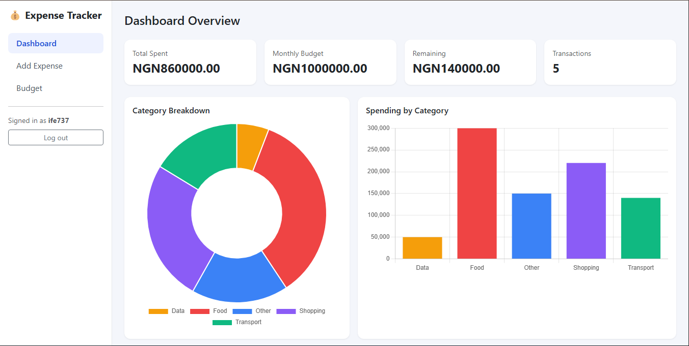
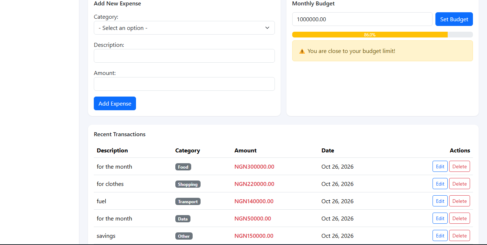
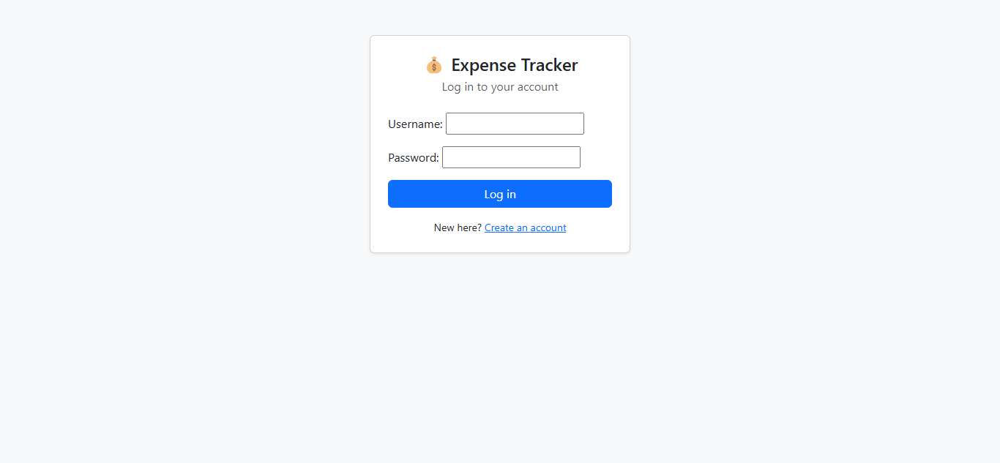
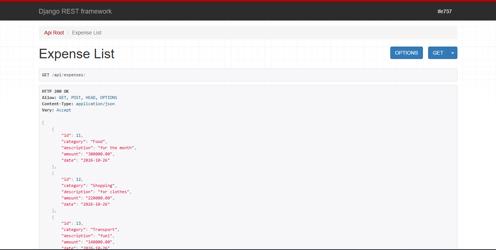

# Expense Tracker

A multi-user expense tracking web app built with Django. Each user signs up, logs expenses, sets a monthly budget and sees their spending on a dashboard. It also exposes a REST API.

**Live demo:** _coming soon_

## Features

- User sign-up, login and logout, with unique usernames and hashed passwords
- Each user only sees and edits their own data
- Add, edit and delete expenses, with validation (amounts must be positive)
- Monthly budget with a progress bar and over-budget warnings
- Dashboard with stat cards, a category donut chart and a bar chart
- REST API for expenses (Django REST Framework), restricted to the logged-in user
- Automated tests that check the ownership and permission rules

## Tech stack

- Python 3.13, Django, Django REST Framework
- SQLite (development)
- Bootstrap 5 and Chart.js (loaded from a CDN)

## Screenshots







## Run it locally

```powershell
git clone https://github.com/ifeadegoke/expense-tracker.git
cd expense-tracker
python -m venv myenv
myenv\Scripts\activate
pip install -r requirements.txt
cd backend
python manage.py migrate
python manage.py createsuperuser
python manage.py runserver
```

Then open http://127.0.0.1:8000/ and sign up.

## API

All endpoints need a logged-in user.

| Method | URL | Description |
|--------|-----|-------------|
| GET | `/api/expenses/` | List your expenses |
| POST | `/api/expenses/` | Create an expense |
| GET | `/api/expenses/<id>/` | Get one expense |
| PUT / PATCH | `/api/expenses/<id>/` | Update an expense |
| DELETE | `/api/expenses/<id>/` | Delete an expense |

## Tests

```powershell
cd backend
python manage.py test
```

## Project history

This project started as a Streamlit prototype (`app.py`, `main.py`) and was rebuilt in Django to add a real database, authentication, per-user data and an API.